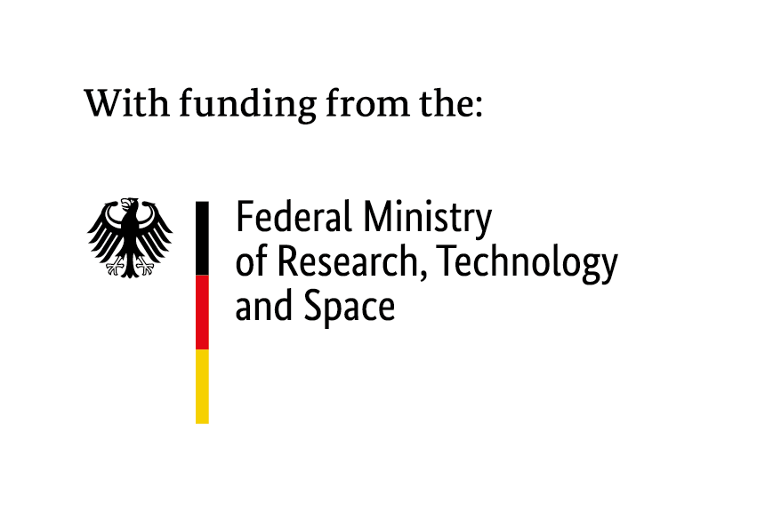

# Real-Time Neural Inference Workshop

From an exported neural model to a real-time-safe audio plugin, in C++.

The workshop starts naive and runs into every problem on purpose: each step fixes the previous step's problem and exposes the next one, until [anira](https://github.com/anira-project/anira) replaces the hand-built infrastructure.

## Before the workshop

Please set up at home. The first configure downloads about 350 MB (the models, ONNX Runtime, JUCE and anira; 400 MB on Windows), and the room's network is shared by everyone. The whole build takes about 1.1 GB of disk.

### 1. Install

You need git, CMake 3.22 or newer, and a C++17 compiler.

- **macOS**: Xcode or the Command Line Tools (`xcode-select --install`), and CMake (`brew install cmake`).
- **Windows**: Visual Studio 2022 with the *Desktop development with C++* workload, and CMake 3.30 or newer.
- **Linux**: `gcc` or `clang`, CMake, and what JUCE needs. Debian and Ubuntu:

  ```bash
  sudo apt install build-essential pkg-config cmake git libasound2-dev libx11-dev libxext-dev libxrandr-dev libxinerama-dev libxcursor-dev libxcomposite-dev libxrender-dev libxi-dev libfreetype-dev libfontconfig-dev libopencv-dev
  ```

  Fedora:

  ```bash
  sudo dnf install gcc-c++ make pkgconf-pkg-config cmake git alsa-lib-devel libX11-devel libXext-devel libXrandr-devel libXinerama-devel libXcursor-devel libXcomposite-devel libXrender-devel libXi-devel freetype-devel fontconfig-devel opencv-devel
  ```

  Arch:

  ```bash
  sudo pacman -S --needed base-devel cmake git alsa-lib libx11 libxext libxrandr libxinerama libxcursor libxcomposite libxrender libxi freetype2 fontconfig opencv
  ```

  OpenCV (`libopencv-dev`, `opencv-devel`, `opencv`) is for the camera in the last step; without it the step still builds, with the mouse instead of a hand.

### 2. Clone, configure, build

```bash
git clone https://github.com/anira-project/realtime-inference-workshop.git
cd realtime-inference-workshop
cmake --preset release
cmake --build --preset release
```

The configure downloads the models and the libraries. The build compiles the libraries and every solution; the first one takes a while (JUCE and anira are built from source), later ones are quick.

### 3. Check

```bash
./build/release/bin/step01_solution
```

On Windows: `build\release\bin\Release\step01_solution.exe`. It loads the model, runs one block and ends with `STEP 1 SOLVED`. Done.

### Just before the workshop

```bash
git pull
cmake --preset release
cmake --build --preset release
```

Only what changed is fetched and rebuilt. If something fails, open an issue with the output, or ask us at the start of the workshop.

For the last step, bring a laptop with a webcam if you have one. The step also runs without a camera, with the mouse.

## During the workshop

Every blank in an exercise is a `?`, in the C++ and in the model files of step 9 and the bonus. Each exercise builds once every `?` in its C++ is filled in, so it is not part of the default build. Build and run one by its target:

```bash
cmake --build --preset release --target step01_exercise
./build/release/bin/step01_exercise
```

Step 9 and the bonus have a check and a plugin: `step09_exercise_check`, `step09_exercise_Standalone` or `step09_exercise_VST3`. Each step's README says what to do and what the output should be.

To step through a task in a debugger, use the debug preset. It builds into `build/debug/`, next to the release build, and fetches the libraries a second time, so do it at home, not on the room's network. Timings, such as the benchmark in step 4, only mean something in the release build.

```bash
cmake --preset debug
cmake --build --preset debug --target step01_exercise
./build/debug/bin/step01_exercise
```

Every configure links `build/compile_commands.json` to its own build folder, so clangd (`.clangd`) follows the build configured last.

## The steps

Part 1, by hand:

1. [Minimal C++ inference](steps/01_minimal_inference/README.md) — load the model, run one block, match the Python reference
2. [Stateless and stateful](steps/02_state/README.md) — pass the state along, and run the whole signal
3. [Model input size vs. host buffer size](steps/03_host_buffer_size/README.md) — ring buffers between the host's block size and the model's
4. [Benchmarking and the real-time budget](steps/04_benchmark/README.md) — how long a forward pass takes, and how long in the worst case
5. [Real-time safety](steps/05_realtime_safety/README.md) — RTSan on the engine; demonstration, no exercise
6. [Inference on a worker thread](steps/06_threading/README.md) — lock-free ring buffers, and an audio thread that allocates nothing
7. [Latency and the dry/wet mix](steps/07_latency/README.md) — what to report to the host, and how to prove it; demonstration, no exercise
8. [The plugin](steps/08_juce_plugin/README.md) — all of it inside JUCE; solution only

Part 2, with anira:

9. [The model with anira](steps/09_anira/README.md) — two JSON files and three calls replace steps 3, 6 and 7
10. [The model as an instrument](steps/10_hands/README.md) — a camera and hand tracking drive the decoder; a JUCE app, no check

Bonus, for after the workshop, with its own [slides](https://anira-project.github.io/realtime-inference-workshop/bonus/):

- [Opening the model](steps/bonus/README.md) — encoder and decoder as two handlers, the latent space in between

## Layout

- `steps/` — one folder per step, with `exercise/` and `solution/`; steps 4, 5, 7 and 8 are solution only, step 10 exercise only
- `steps/common/` — what the steps share: the engine, the ring buffers, the fake host and the reporting in `helpers/`, the test signal, audio and models in `assets/`
- `cmake/` — the dependencies: ONNX Runtime, the models, anira, JUCE
- `slides/` — the Reveal.js slides, built by `scripts/build.js`
- `scripts/` — the slide build, the model export and the test data, and `fill_exercise.py`

The models are not in git; the configure downloads them. [steps/common/assets/models/README.md](steps/common/assets/models/README.md) has what they are and where they come from.

## Options

- `-DWORKSHOP_STEP=01` — configure a single step (`bonus` for the bonus)
- `-DWORKSHOP_ANIRA=OFF` — leave part 2 out
- `-DWORKSHOP_JUCE=OFF` — leave the plugin steps out
- `-DWORKSHOP_RTSAN=ON` — step 5 with RealtimeSanitizer; needs a clang that has it, see the [step's README](steps/05_realtime_safety/README.md)
- `-DWORKSHOP_HOST_SLOWDOWN=4` — for CI: the host loop of steps 6 and 7 calls back four times slower, and step 4 allows four model blocks per forward pass, since a shared runner does not keep up with real time
- `-DWORKSHOP_CHECK_EXERCISES=ON` — for maintainers: every exercise, its `?` filled in from the solution by [`scripts/fill_exercise.py`](scripts/fill_exercise.py), has to build and pass like the solution (`stepNN_exercise_filled`, `step09_exercise_filled_check`). CI runs them on every push; locally it needs Python 3.

## Funding

The workshop is part of the [anira](https://github.com/anira-project/anira) project, funded by the German Federal Ministry of Research, Technology and Space (BMFTR).



## License

Code, slides, text and the example audio: [Apache 2.0](LICENSE).

Not part of that, each under its own license:

- The Realtime Audio Variational autoEncoder model, exported from the Intelligent Instruments Lab's magnetic resonator piano model: [CC BY-NC 4.0](https://huggingface.co/Intelligent-Instruments-Lab/rave-models), non-commercial. It is not in git; the configure downloads it.
- The hand tracking models (`handtracking/`), MediaPipe's: Apache 2.0.
- The fonts in `slides/assets/fonts/`: SIL Open Font License 1.1.
