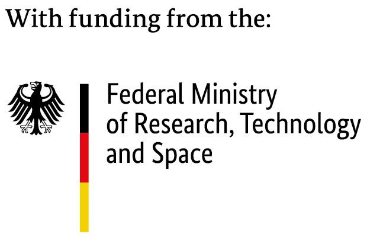
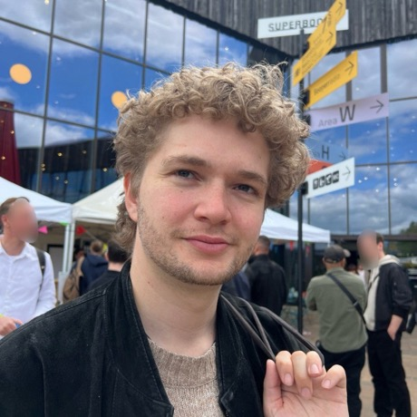
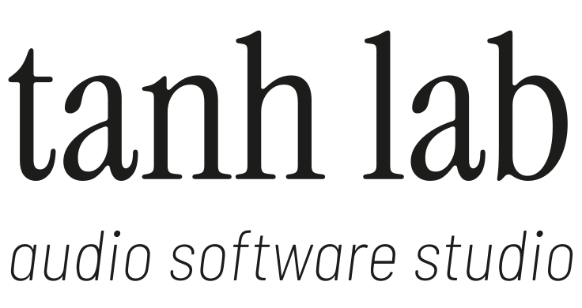

<!-- .slide: class="title-card" data-background-image="assets/images/adc26-title.webp" data-background-size="contain" data-state="no-chrome" -->

Note:
- When the session starts, go to the next slide.

---

<h1>Real-Time Neural<br>Inference</h1>

From an exported neural model to a real-time-safe audio plugin

Lina Campanella · Fares Schulz · Valentin Ackva

<div class="title-logos">
  
</div>

<!-- .slide: data-state="no-header" -->

Note:
- Hi all
- Welcome to our workshop on real-time inference of neural networks.
- Today we take an exported neural network model and implement it in an audio environement in a real-time safe manner

---

<div class="tag">Teaser · A</div>

## Every callback has a deadline<br><span class="then">An FFT on 2048 samples: cheap, and equally cheap every time.</span>

<div class="teaser" data-teaser="clock" data-work="fft"><canvas></canvas></div>

Note:
- What you see: one turn of the clock is one callback. The host gives us 512 samples, and the next 512 are due one turn later
- An FFT on blocks of 2048: three callbacks only collect, the 4th runs FFT and IFFT
- That is the pattern you know from STFT and FFT convolution: a FIFO collects the block, the callback that completes it does the transform, and we report 2048 samples of latency to the host
- The block sizes don't match, and that only costs latency
- FFT and IFFT take about 3 µs on our laptop (FFTW), roughly a tenth of a sample. The tick on the clock is drawn much thicker than that
- The boxes on the right: time per block, in samples. The same for every block: an FFT does the same operations, whatever the audio is
- Three callbacks idle, one does all the work. Spiky, but with thousands of times headroom it doesn't matter. Every callback is on time

---

<div class="tag">Teaser · B</div>

## Every callback has a deadline<br><span class="then">A network on 2048 samples: too slow, and its time varies.</span>

<div class="teaser" data-teaser="clock" data-work="nn"><canvas></canvas></div>

Note:
- Same clock, same 2048-sample block. Only the FFT is replaced by our neural network
- The block sizes don't match, as with the FFT: four callbacks collect, the 4th runs the network. That part we know how to handle
- New problem 1: the forward pass takes about 570 samples' worth of time (13 ms on ONNX Runtime, step 3), more than the 512 a callback has. It doesn't fit
- New problem 2: by how much it misses changes every time, sometimes far more. The runtime is not deterministic
- The boxes on the right: time per block, in samples, red when it is more than the 512 a callback has. The newest one counts while the network runs
- The times shown are illustrative, after step 3's measurements
- The question: how do we fit a fixed-size, non-deterministic model into a callback with varying block sizes and a hard deadline? That is today's workshop

---


<div class="tag">introduction</div>

## anira<br><span class="then">Research on real-time inference since 2020</span>

<div class="brand anira">
  
  <ul class="checks">
    <li>Commercially usable: Apache 2.0</li>
    <li>Any inference engine: LibTorch, ONNX Runtime, LiteRT, ExecuTorch</li>
    <li>Real-time safe, with minimal latency</li>
  </ul>
  <div class="row-label">Platforms:</div>
  <div class="platforms">
    <figure><figcaption>macOS</figcaption></figure>
    <figure><figcaption>Windows</figcaption></figure>
    <figure><figcaption>Linux</figcaption></figure>
    <figure><figcaption>iOS</figcaption></figure>
    <figure><figcaption>Android</figcaption></figure>
    <figure><figcaption>Browser</figcaption></figure>
  </div>
  <div class="row-label">Prev. talks:</div>
  <div class="talks">
    <a class="talk" href="https://www.youtube.com/watch?v=z_RKgHU59r0" target="_blank"><span class="talk-event">ADC23</span>Real-Time Inference of Neural Networks: A Guide for DSP Engineers</a>
    <a class="talk" href="https://www.youtube.com/watch?v=p-WwttPZJ_o" target="_blank"><span class="talk-event">ADC24</span>Real-Time Inference of Neural Networks, Part II</a>
  </div>
</div>

Note:
- The short answer to solve this problem, you can use our anira library.
- It is an open-source library for real-time inference.
- You give it a model for LibTorch, ONNX Runtime, LiteRT or ExecuTorch, and it takes care of the threads, the buffering and the latency.
- It is the outcome of our work and research about real-time inference since 2020.
- If you want you can also look at our earlier implementation proposals, which we presented at ADC23 and ADC24.

---

<div class="tag">introduction</div>

## About us

<div class="people">
  <div class="person">
    
    <div class="person-name">Lina Campanella<span class="person-pronouns">she/her</span></div>
    <div class="person-role">Student Assistant</div>
    <div class="person-affiliation">TU Berlin</div>
  </div>
  <div class="person">
    
    <div class="person-name">Fares Schulz<span class="person-pronouns">he/him</span></div>
    <div class="person-role">Research Associate & Freelance Software Developer</div>
    <div class="person-affiliation">TU Berlin · tanh lab</div>
  </div>
  <div class="person">
    
    <div class="person-name">Valentin Ackva<span class="person-pronouns">he/him</span></div>
    <div class="person-role">Audio Software Developer</div>
    <div class="person-affiliation">Baby Audio · tanh lab</div>
  </div>
</div>

Note:
- So who are we?
- Lina is a student assistant at TU Berlin.
- I am a research associate at TU Berlin leading the Computer Music and Neural Audio Systems research team, and together with Valentin I run tanh lab.
- In addition Valentin also works as an audio software developer at Baby Audio.

---

<div class="tag">introduction</div>

## tanh lab<br><span class="then">From research to product.</span>

<div class="brand studio">
  
  <div class="brand-body">
    <div class="studio-rows">
      <div class="studio-row">{{ICON:chip}}<div class="card-title">Research</div><ul class="card-points"><li>DSP and machine learning</li><li>Feasibility studies, prototypes</li></ul></div>
      <div class="studio-row">{{ICON:model}}<div class="card-title">Custom models</div><ul class="card-points"><li>Neural networks for audio</li><li>On device, in real time</li></ul></div>
      <div class="studio-row">{{ICON:plug}}<div class="card-title">Full stack</div><ul class="card-points"><li>Plug-ins, apps, mobile, web</li><li>From method to product</li></ul></div>
    </div>
    <div class="cards-note">tanh-lab.com · we develop and maintain anira</div>
  </div>
</div>

Note:
- So whats tanh lab.
- Tanh lab is an audio software studio based in berlin.
- We take ideas from research all the way to a product.
- Our work ranges from applied research, evaluating the feasibility of an idea to the full stack implementation and deployment of the product.
- We are also the maintaining the open source and permissively licensed anira library.

---

<div class="tag">Scope</div>

## From an exported model<br>to real-time safe inference in a plugin.

<div class="cards spanned">
  <div class="card">{{ICON:model}}<div class="card-title">Exported model</div><div class="card-text">Trained, exported, given</div></div>
  <div class="card-arrow">→</div>
  <div class="card">{{ICON:chip}}<div class="card-title">Inference in C++</div><div class="card-text">Engines, block sizes, worst case</div></div>
  <div class="card-arrow">→</div>
  <div class="card">{{ICON:shield}}<div class="card-title">Real-time safe</div><div class="card-text">Worker thread, latency</div></div>
  <div class="card-arrow">→</div>
  <div class="card">{{ICON:plug}}<div class="card-title">Plugin</div><div class="card-text">All of it, in a host</div></div>
  <div class="cards-span" style="margin-bottom: 200px;"><span>Workshop Scope</span> How to solve these three steps</div>
</div>


<div class="cards-note">Not today: training, exporting, ML fundamentals, Python.</div>

Note:
- Now lets talk about the workshop.
- Today's path starts from an exported model (get it from data scientist) already trained and exported.
- We will run this model in C++, and see what the engine, the block size and the worst case mean for us.
- We make it real-time safe, with a worker thread and an honest latency.
- And we put all of it into a plugin that runs in your host.
- anira solves these three steps, but in order to understand why it is usefull, today you will build it by hand first.
- So today we are not going to cover: training, exporting, machine learning basics or Python.

---


## Who this is for<br><span class="then">We assume you write real-time audio code in C++.</span>

<div class="prereqs">
  <div class="prereq">
    <div class="prereq-label">Expected knowledge</div>
    <div class="prereq-text">C++, and the audio thread's rules</div>
  </div>
  <div class="prereq optional">
    <div class="prereq-label">Helpful knowledge, not required</div>
    <div class="prereq-text">Neural network basics</div>
  </div>
</div>

Note:
- Who is this for?
- We assume you write real-time audio code in C++.
- You know the rules of the audio thread: no allocations, no locks, no waiting.
- Neural network basics help, but you do not need them.

---

## Follow along

<div class="qr-row">
  <div class="qr">
    {{QR:HTTPS://GITHUB.COM/ANIRA-PROJECT/REALTIME-INFERENCE-WORKSHOP}}
    <div class="qr-label">Repository</div>
    <div class="qr-url">github.com/anira-project/realtime-inference-workshop</div>
  </div>
</div>

Note:
- Follow along: everything we show is in this repository.
- Please scan the code now, or type the address.
- The slides are linked there too, top right on the GitHub page.
- If you cannot read the screen well, click through them on your own machine.
- If you have not built the code yet, clone it and start the configure step now, so it runs while we talk.

---

<div class="tag">Setup</div>

## Set up now<br><span class="then">Clone, configure and build while we talk.</span>

```bash
git clone https://github.com/anira-project/realtime-inference-workshop.git
cd realtime-inference-workshop
cmake --preset release           # about 350 MB: models, ONNX Runtime, JUCE, anira
cmake --build --preset release   # libraries and solutions
```

<div class="cards-note">Release, because we benchmark the model later.</div>

<div class="cards-note">Cloned it at home already? <code>git pull</code> and configure again: only what changed is fetched.</div>

Note:
- We sent the setup instructions by email. If you did it at home: thank you, just pull and configure again.
- If not: please start now. Clone, configure, build.
- Configuring downloads about 350 MB: the models, ONNX Runtime, JUCE and anira. The room's network is shared, so the earlier the better.
- It runs while we talk. Building the libraries and every solution takes a while too, so start the build right after. The exercises build on their own, once you fill them in.
- Why release? There is a benchmark in the examples, which is only meaningful in release.
- Debugging works too: `cmake --preset debug` builds into `build/debug/`, next to the release build. But it fetches ONNX Runtime, JUCE and anira a second time, so please do it at another moment, not now on the shared network.
- If configuring fails, raise your hand and we come to you.
- Please! do not wait for the first exercise: that is the worst moment to start a download.

---

## Agenda

{{AGENDA}}

Note:
- The workshop has two parts.
- In the first part we build real-time inference by hand, step by step, up to a plugin.
- In the second part we replace the hand-built parts with anira.

---

<div class="tag">explanation</div>

## How the exercises work <br>

<span class="then">Each step: a short introduction, then an exercise.<br>A reference solution is in the repository.</span>

<div class="cards" style="margin-bottom: 200px;"> 
  <div class="card">{{ICON:slides}}<div class="card-title">Slides</div><div class="card-text">The problem, and the idea for fixing it</div></div>
  <div class="card-arrow">→</div>
  <div class="card accent">{{ICON:code}}<div class="card-title"><code>exercise/</code></div><div class="card-text">Your code, with TODOs to fill in</div></div>
  <div class="card-arrow">→</div>
  <div class="card">{{ICON:folder}}<div class="card-title"><code>solution/</code></div><div class="card-text">To compare, or to catch up</div></div>
</div>

Note:
- How do the exercises work?
- Every step follows the same pattern.
- On the slides we show the problem and the idea for fixing it.
- Then you fill in the TODOs in exercise/.
- You can check if you got the right solution by running the exercise.
- If you get stuck, or want to compare, the solution is in solution/.

