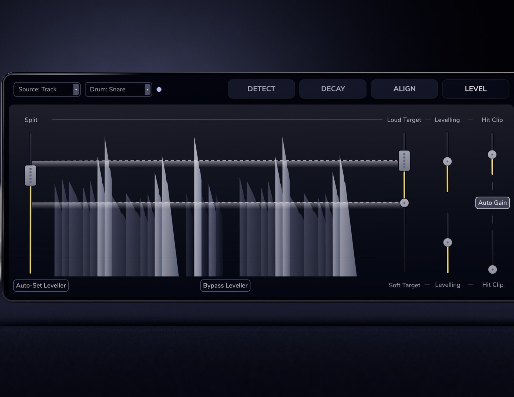
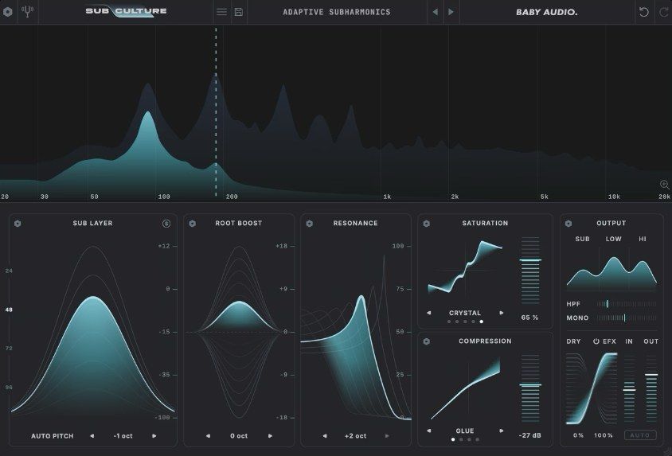
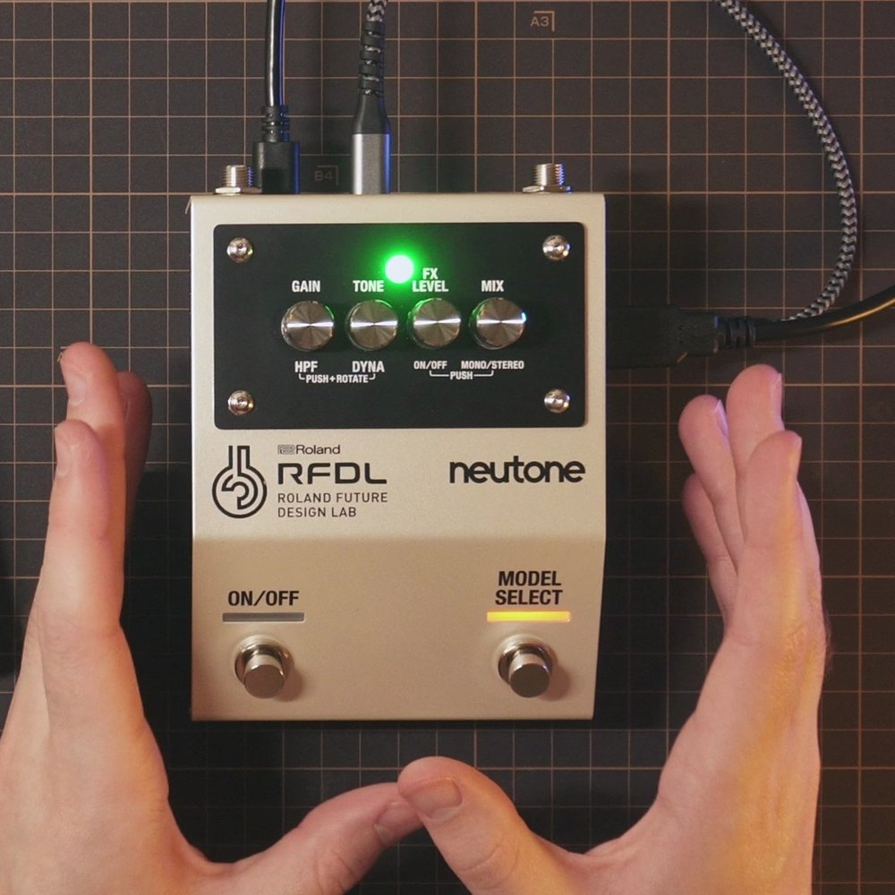

<h1>anira</h1>

Replacing the hand-built parts

<!-- .slide: data-state="no-header" -->
<!-- kind: talk -->
<!-- part: anira -->

Note:
    - Part 2. Everything in part 1 was built so that this part can name it.
    - Talk first: what anira is, then the concepts one by one, then the architecture. Hands-on after that.

---

Part 1

## Six things real-time inference needs. We solved each one, the simple way.

  
{{ICON:model}}
Inference

steps 1, 2, 4 · one engine, one block size

  
{{ICON:gauge}}
Benchmarking

step 3 · one benchmark, on our machine

  
{{ICON:shield}}
Real-time safety

step 5 · RTSan, run once

  
{{ICON:threads}}
Threading

steps 6, 8 · a worker per channel

  
{{ICON:clock}}
Minimal latency

step 7 · a prefill, counted by hand

  
{{ICON:flag}}
Real-time guarantees

steps 3, 7 · hoping the budget holds

  
anira has an answer to all six, built for production: from one plugin instance to many.

Note:
    - What we did in part 1, as six needs. Every one works, and every one is the simple version: one engine, one machine, one instance.
    - Click once: anira covers all six, from years of plugins in production. Not how yet; the next two chapters open them one by one.
    - The dry path is the one thing that stays in your code: anira reports the number, the mix is the plugin's.

---

What anira is

## A C++ library for real-time inference. Configure once, run everywhere.

  
You configure

  
Real-time

  
Everywhere

  
{{FILE:model.json}}{{FILE:contract.json}}

  
→

  

    
{{ICON:cpp}}

    
threads · buffers · latency · safety

    
one C ABI↓
C++TypeScript

  

  
→

  

    

      
Engines

      

        <figure><figcaption>LibTorch</figcaption></figure>
        <figure><figcaption>ONNX Runtime</figcaption></figure>
        <figure><figcaption>LiteRT</figcaption></figure>
        <figure><figcaption>ExecuTorch</figcaption></figure>
        <figure>{{ICON:code}}<figcaption>Custom</figcaption></figure>
      

    

    

      
Devices

      

        <figure class="device desktop">

<figcaption>Desktop</figcaption></figure>
        <figure class="device phone">

<figcaption>Mobile</figcaption></figure>
        <figure class="device browser">

<figcaption>Web</figcaption></figure>
        <figure class="device board">
Bela
<figcaption>Embedded<small>ARMv7 · ARM64</small></figcaption></figure>
      

    

    

      
Hosts

      

        {{ICON:plug}}Audio plugins
        {{ICON:slides}}Standalone apps
        {{ICON:wave}}<code>anira~</code> in Max/MSP
        {{ICON:camera}}Real-time video
      

    

  

Note:
    - What part 1 built by hand is the inside of anira. You only say what the model is and what the host promises; the rest is the library's.
    - Audio plugins first, and real-time video since the async contract: step 11 runs hand tracking on camera frames.
    - Since v3 the library is one versioned C ABI. The C++ API and the TypeScript package on npm are generated from it, so every language sees the same library.
    - Click: every engine, or your own. Click: desktop, mobile, the browser, and embedded boards like Bela, on ARMv7 and ARM64. Click: in a plugin or a standalone app, as the anira~ external in Max/MSP, or on camera frames. Solve it once.

---

In production

## Battle-tested in the industry. Two plugins on sale, one hardware project.

  <figure class="fragment">

<figcaption>Sonnox · PluginOxford Drum Gate 2</figcaption></figure>
  <figure class="fragment">

<figcaption>Baby Audio · PluginSubCulture</figcaption></figure>
  <figure class="fragment">

<figcaption>Neutone · EmbeddedProject LYDIA</figcaption></figure>

Note:
    - Sonnox Oxford Drum Gate 2 (February 2026): the gate classifies drum hits by timbre, not level. Its models run through anira.
    - Baby Audio SubCulture (July 2026): pitch-tracking bass enhancer; its models run through anira.
    - Project LYDIA by Neutone: Neutone's Morpho on a Raspberry Pi 5, the embedded case from the slide before. A hardware project, not a product on sale yet.
    - Two commercial plugins on every desktop host, and a pedal on ARM: the same library in all three.
    - Images: the Sonnox hero shot and the Baby Audio screenshot from their product pages, the pedal from Neutone.

---

How you use it

## Three configs say what, how, and with what. The handler runs it.

  
{{ICON:model}}
ModelConfig

what: the files, every tensor, its role

  
→

  
{{ICON:sliders}}
Contract

how: <em>Hard</em> for a stream, <em>Async</em> for jobs

  
→

  
{{ICON:chip}}
ContextConfig

with what: threads, engines, log

  
→

  
{{ICON:shield}}
Handler

<code>prepare</code> · <code>process</code> · <code>get_latency</code>

Two JSON files and three calls. The rest is the library's. Today: v3.0.0-beta, pinned by CMake.

Note:
    - ModelConfig: which files, which engines may run them, every tensor with a name and a role (streamed, static, state).
    - Contract: what the host promises and what it gets. Hard: a block size range, a time budget, what happens on a miss; the latency follows from it. Async: a job with a deadline, for things like a camera frame. Everything in the hands-on is Hard, except the hand tracking in step 11.
    - Version: the workshop pins the v3 beta tag; CMake fetches it with ONNX Runtime built in.
    - ContextConfig: the process-wide part, threads and enabled engines. One per process, like the pool.
    - Handler: the three calls from step 8, prepareToPlay, processBlock and setLatencySamples, one each.

---

Why anira

## One plugin, two threads. Ten plugins, twenty threads, eight cores.

  

    
instance 1<i></i><i></i>

    
instance 2<i></i><i></i>

    
instance 3<i></i><i></i>

    
instance 4<i></i><i></i>

    
instance 5<i></i><i></i>

    
instance 6<i></i><i></i>

    
instance 7<i></i><i></i>

    
instance 8<i></i><i></i>

    
instance 9<i></i><i></i>

    
instance 10<i></i><i></i>

  

  

    8 cores
    <b style="--i:0"></b><b style="--i:1"></b><b style="--i:2"></b><b style="--i:3"></b>
    <b style="--i:4"></b><b style="--i:5"></b><b style="--i:6"></b><b style="--i:7"></b>
  

  
<strong>20</strong> real-time threads on <strong>8</strong> cores

Note:
    - Why it exists at all. Step 8 ended here: one engine and one worker per channel, per instance. The host does not know, and keeps adding instances.
    - Real-time threads that outnumber cores take turns. A worker that is not scheduled misses its block, and the miss lands in someone else's plugin.
    - This is the problem anira was written for. Everything else followed from it.

---

History

## Written for that problem, in 2024.

  

2023

ADC23

one inference thread per plugin

  

2024

anira · ADC24

one pool per process; IS² paper

  

11/2024

v1

context, multichannel

  

07/2025

v2

any tensor, not only audio

  

2026

v2.1 – v2.3

web, mobile, generators

  

2026

v3

one C ABI, every host

Apache 2.0 · tanh lab, TU Berlin · funded by BMFTR since 2026

Note:
    - ADC23 (London): the nn-inference-template, an inference thread per plugin, and the oversubscription slide at the end.
    - ADC24 (Bristol): anira, with the static thread pool, and the IEEE IS² 2024 paper, which won the Industry Award.
    - v1: anira::Context, one pool shared by every handler; multichannel. v2: arbitrary tensors, non-audio inputs and outputs, different rates in and out.
    - 2026: web (WASM), Android and iOS, LiteRT and ExecuTorch, generators and analysers, a closed-form latency. Then v3: a versioned C ABI, so every host and language sees the same library.
    - Since 2026 funded by the BMFTR through the Prototype Fund; Lina joined the team.

---

Take away

## Three kinds of thread. Each does one thing.

  
The main thread plans: configs, <code>prepare</code>, the latency

  
The audio thread moves samples: <code>process</code>, nothing else

  
The pool runs the models

Note:
    - That is the whole library in one sentence. The next two chapters go through the concepts behind it, each one starting from the step in part 1 that built it by hand.
