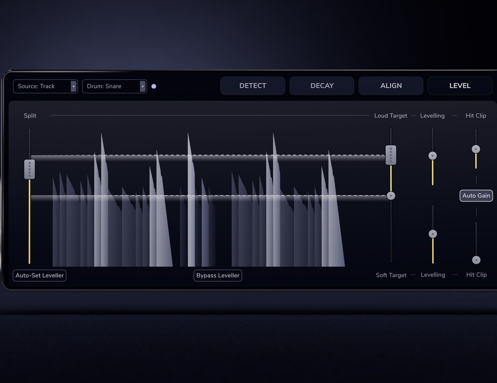
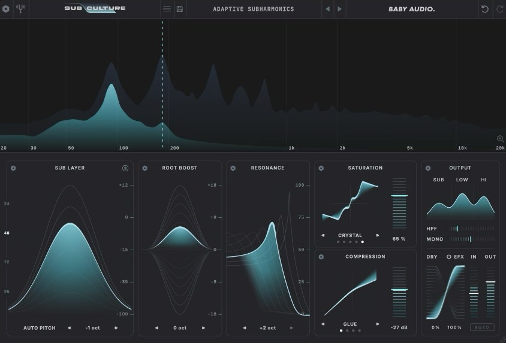
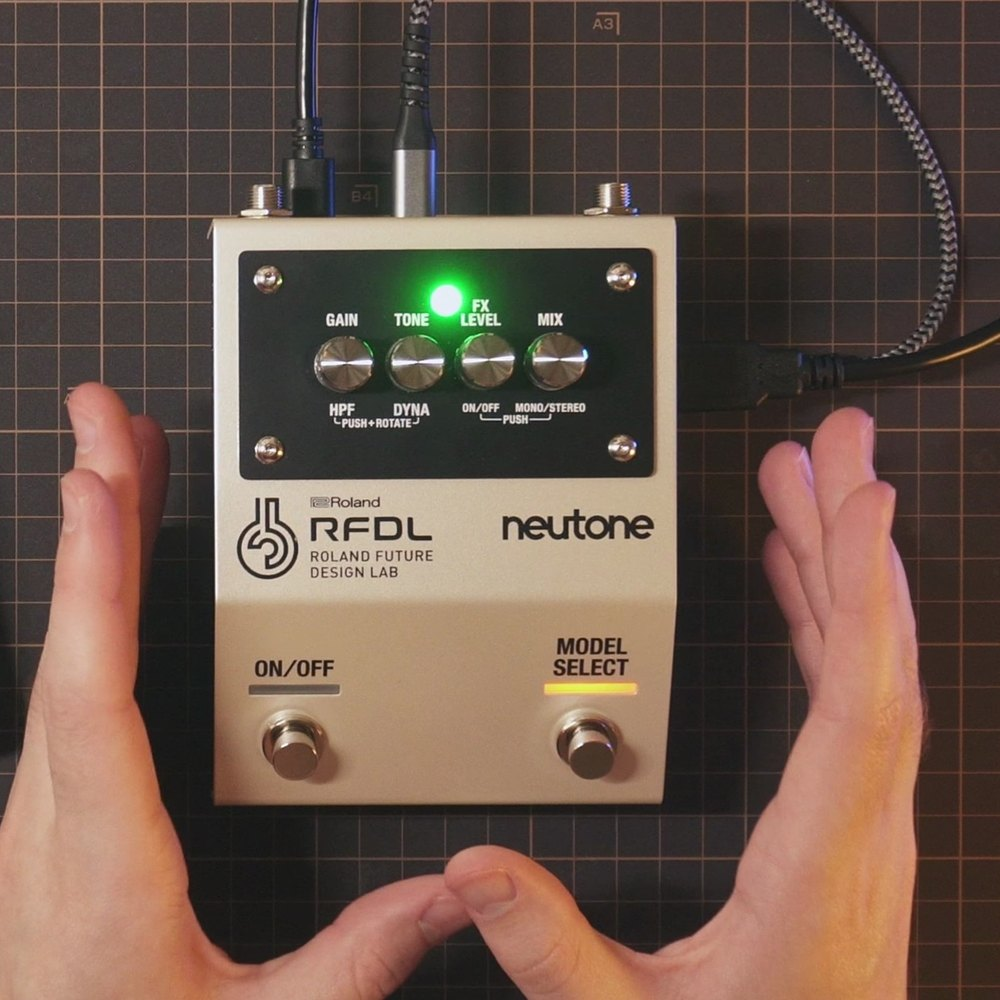

<h1>anira</h1>

Replacing the hand-built parts

<!-- .slide: data-state="no-header" -->
<!-- kind: talk -->
<!-- part: anira -->

Note:
- Welcome back.
- In part 1 you built inference for one case.
- One model, one host block size, one fixed model input size.
- Change any of the three, and you redo many of those steps.
- That's why we built anira, to simplify that process.
- In part 2, I first show what anira is and where it comes from.
- Then Fares shows you how it works inside.
- After that, you use anira in the exercises, starting with step 9.

---

Part 1

## Six things real-time inference needs. We solved each one, the simple way.

  
{{ICON:model}}
Inference

steps 1, 2, 3 · one engine, one block size

  
{{ICON:gauge}}
Benchmarking

step 4 · one benchmark, on our machine

  
{{ICON:shield}}
Real-time safety

step 5 · RTSan, run once

  
{{ICON:threads}}
Threading

steps 6, 8 · a worker per plugin instance

  
{{ICON:clock}}
Minimal latency

step 7 · a prefill, counted by hand

  
{{ICON:flag}}
Real-time guarantees

steps 4, 7 · hoping the budget holds

  
anira covers all six, for one plugin instance or many.

Note:
- In part 1 we built six things by hand.
- We ran the inference.
- We benchmarked it on our machine.
- We checked the engines for real-time safety.
- We gave each plugin instance one worker thread.
- We calculated the minimal latency.
- And we made sure the real-time thread is never blocked.
- [pause, then click] anira covers all six, for one plugin instance or many.
- So: what is anira?

---

What anira is

## A C++ library for real-time inference. One configuration, several engines and platforms.

  
You configure

  
Real-time

  
Everywhere

  
{{FILE:model.json}}{{FILE:contract.json}}

  
→

  

    
{{ICON:cpp}}

    
threads · buffers · latency · safety

    
one C ABI↓
C++TypeScript

  

  
→

  

    

      
Engines

      

        <figure><figcaption>LibTorch</figcaption></figure>
        <figure><figcaption>ONNX Runtime</figcaption></figure>
        <figure><figcaption>LiteRT</figcaption></figure>
        <figure><figcaption>ExecuTorch</figcaption></figure>
        <figure>{{ICON:code}}<figcaption>Custom</figcaption></figure>
      

    

    

      
Devices

      

        <figure class="device desktop">

<figcaption>Desktop</figcaption></figure>
        <figure class="device phone">

<figcaption>Mobile</figcaption></figure>
        <figure class="device browser">

<figcaption>Web</figcaption></figure>
        <figure class="device board">
Bela
<figcaption>Embedded<small>ARMv7 · ARM64</small></figcaption></figure>
      

    

    

      
Hosts

      

        {{ICON:plug}}Audio plugins
        {{ICON:slides}}Standalone apps
        {{ICON:wave}}<code>anira~</code> in Max/MSP
        {{ICON:camera}}Real-time video
      

    

  

Note:
- anira is a C++ library.
- You describe the model, and what the host promises.
- anira takes care of threads, buffers and latency.
- Underneath is one C ABI [say: C, A-B-I], with C++ and TypeScript on top.
- [click] anira has the most common inference engines built in, and you can also bring your own.
- [click] It runs on desktop, mobile, in the browser, and on embedded platforms like Bela or a Raspberry Pi.
- [click] We also provide examples of how to run anira in an audio plugin or a standalone app.
- There is a Max/MSP external, and even a demo of real-time video inference.

---

In production

## anira in products. A selection.

  <figure class="fragment">

<figcaption>Sonnox · PluginOxford Drum Gate 2</figcaption></figure>
  <figure class="fragment">

<figcaption>Baby Audio · PluginSubCulture</figcaption></figure>
  <figure class="fragment">

<figcaption>Neutone · EmbeddedProject LYDIA</figcaption></figure>

Note:
- anira started as a research project.
- Nowadays it already ships in released products.
- [click] Sonnox Oxford Drum Gate 2 uses anira to classify drum hits.
- [click] In Baby Audio SubCulture, it helps tracking the pitch.
- [click] And Neutone uses it on an embedded device for timbre transfer, in Project LYDIA.
- So how did we get here? Well, not in one go.

---

History

## How anira evolved. From one thread per plugin to one C ABI.

  

2023

ADC23

one inference thread per plugin

  

2024

IS² paper

anira, presented scientifically

  

2024

ADC24

anira v1 on stage

  

07/2025

v2

any tensor, not only audio

  

2026

Mobile · Web

iOS, Android and the web

  

2026

v3 pre-release

one C ABI; what this workshop runs

  

end of 11/2026

v3.0

the release

Have you thought about many instances? Every plugin opens its own real-time thread.the sonible team, after the talk

Note:
- The timeline runs from 2023 to the end of this month!
- First stop, ADC23: we showed a plugin template.
- It is the design you built in part 1: a worker, a ring buffer each way, a prefill.
- It worked, for one plugin.
- [click] After the talk the sonible team asked: have you thought about many instances?
- Each instance spawns its own real-time thread!
- A fair question, so let's look at what it means.

---

anira v1

## A library has to solve this, not a plugin. Eight instances, eight real-time threads, four cores.

  

    
instance 1<i></i>

    
instance 2<i></i>

    
instance 3<i></i>

    
instance 4<i></i>

    
instance 5<i></i>

    
instance 6<i></i>

    
instance 7<i></i>

    
instance 8<i></i>

  

  

    4 cores
    <b style="--i:0"></b><b style="--i:1"></b><b style="--i:2"></b><b style="--i:3"></b>
  

  
<strong>8</strong> real-time threads on <strong>4</strong> cores

  
In a plugineach instance starts its own thread and cannot see the others

  
In a libraryone thread pool per process, shared by every instance

Note:
- Let's imagine we suddenly have eight instances of our plugin
- But only four logical cores on our hardware.
- Then we run into a problem called oversubscription: more real-time threads than cores.
- The OS has to step in and give each thread its time to run, which drags down overall performance.
- [click] To address this, we need a solution that works across all instances.
- Ideally across multiple products.
- Solution: A static thread pool, which all products can use to run their inference.
- Therefore we decided to develop a library to do that.
- That was anira v1.

---

History

## How anira evolved. From one thread per plugin to one C ABI.

  

2023

ADC23

one inference thread per plugin

  

2024

IS² paper

anira, presented scientifically

  

2024

ADC24

anira v1 on stage

  

07/2025

v2

any tensor, not only audio

  

2026

Mobile · Web

iOS, Android and the web

  

2026

v3 pre-release

one C ABI; what this workshop runs

  

end of 11/2026

v3.0

the release

Note:
- This library design then was presented and published as paper at the Internet of Sounds conference in 2024.
- And we talked about it at ADC24

---

History

## How anira evolved. From one thread per plugin to one C ABI.

  

2023

ADC23

one inference thread per plugin

  

2024

IS² paper

anira, presented scientifically

  

2024

ADC24

anira v1 on stage

  

07/2025

v2

any tensor, not only audio

  

2026

Mobile · Web

iOS, Android and the web

  

2026

v3 pre-release

one C ABI; what this workshop runs

  

end of 11/2026

v3.0

the release

Note:
- In July 2025 we hit the next limitation of anira.
- [pause] Until then anira only moved audio in and audio out, one block each.
- What was missing?
- The option to also process non-audio data, like features or predictions.
- So with v2, every input and output became a tensor.
- Each one has its own shape and its own rate.

---

History

## How anira evolved. From one thread per plugin to one C ABI.

  

2023

ADC23

one inference thread per plugin

  

2024

IS² paper

anira, presented scientifically

  

2024

ADC24

anira v1 on stage

  

07/2025

v2

any tensor, not only audio

  

2026

Mobile · Web

iOS, Android and the web

  

2026

v3 pre-release

one C ABI; what this workshop runs

  

end of 11/2026

v3.0

the release

funded by the BMFTR since 2026

Note:
- Earlier this year, we also ported the library to the web, since more and more audio processing moves there.
- [point at the note] Then we received public funding to develop anira further.
- With it came iOS and Android
- And the bigger goal: to support video, images and text, next to audio.
- v2 could not stretch that far, so we started a new design: v3.

---

anira v3

## Where v2 reached its limits. What v3 changes.

  

    {{ICON:model}}
    
v2audio buffers, in float

    
v3
<b>audio</b><b>image</b><b>text</b>
typed tensors: ten dtypes, an image is a tensor too

  

  

    {{ICON:code}}
    
v2TypeScript wraps the C++ API

    
v3
<b class="core">C ABI</b><i>→</i><b>C++</b><b>TypeScript</b>
one versioned binary contract

  

  

    {{ICON:clock}}
    
v2built around the audio stream

    
v3
<b>Hard · stream</b><b>Async · job</b>
Hard today, Async later

  

  

    {{ICON:chip}}
    
v2data passes through CPU memory

    
v3
<b>CPU</b><b>GPU</b><b>NPU</b>
one tensor type on every device

  

Note:
- Why? v2 was built for audio plugins on the desktop, and that is where it reached its limits.
- [click] v3 now takes any kind data: audio, images and text.
- [click] We provide one clean C ABI at the core, with C++ and TypeScript on top of it.
- [click] Two contracts: Hard for a stream (what we do doay)
- But also support for Async for jobs, which is not streamed.
- [click] And we will support all tensor type. v2 only supports CPU, with v3 we will also support GPU and NPU. Which also means GPU and NPU inference!

---

History

## How anira evolved. From one thread per plugin to one C ABI.

  

2023

ADC23

one inference thread per plugin

  

2024

IS² paper

anira, presented scientifically

  

2024

ADC24

anira v1 on stage

  

07/2025

v2

any tensor, not only audio

  

2026

Mobile · Web

iOS, Android and the web

  

2026

v3 pre-release

one C ABI; what this workshop runs

  

end of 11/2026

v3.0

the release

Apache 2.0

Note:
- Last stop: today you run v3.alpha3, pinned in the workshop's CMake.
- v3.0 is planned for the end of the month.
- That is the history; Now Fares, will talk about anira's inside.

